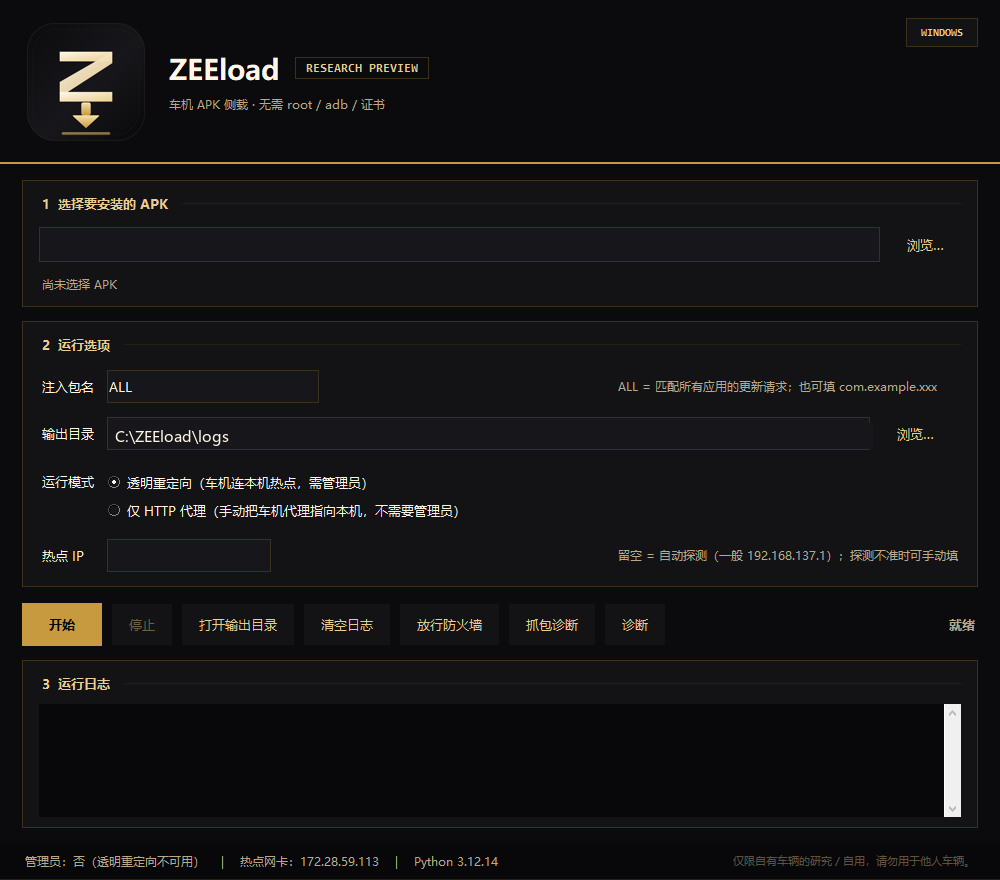

# ZEEload · Windows 版

> ⚠️ **仅适用于自行搭建的车机平台**（自建热点 + 模拟车机 + 模拟商店响应），**仅是系统安全防护思路**的研究记录，**不得用于任何生产环境**，也不针对任何真实厂商设备与线上服务。

把任意 APK 通过**车机应用商店的「检查更新」通道**装进车机，原理与 macOS 版完全一致：

```text
车机 ──Wi-Fi──> Windows 移动热点
                  │
                  ├─ WinDivert 把发往 443 的包改写到 热点IP:18081
                  ├─ 本地 SNI 分流器读出域名，用 HTTP CONNECT 交给 mitmproxy
                  ├─ mitmproxy（透明解密）+ 注入假更新 + 替换下载内容
                  └─ 回程流量把源地址改回原目标，车机无感
```

## 前提

| 项目 | 要求 |
|---|---|
| 系统 | Windows 10 / 11（x64） |
| Python | **3.12 及以上**（实测 3.12.14；mitmproxy 12.3+ 的硬性要求） |
| mitmproxy | **12.3 及以上**（实测 12.3.1；`--emudhra` 从 12.3 起提供） |
| pydivert | 3.1+（实测 3.1.3；由 mitmproxy 12.3 的 `pydivert<=3.1.3` 约束解析，自带 WinDivert 驱动） |
| 安装命令 | `py -3.12 -m pip install -U mitmproxy pydivert` |
| 权限 | **必须管理员**（加载 WinDivert 驱动） |
| 网络 | Windows 开启「移动热点」，车机连上这个热点；Windows 自身能上网 |
| 车机 | 需仍信任某公共 CA 的根证书（对应 2026-10 中间 CA 私钥泄露事件；此后更新过信任库的设备可能失效） |

## 安装

```powershell
# 以管理员身份打开 PowerShell
cd windows
py -3.12 -m pip install -U mitmproxy pydivert   # 默认 python 若是 3.10/3.11，请用 py -3.12
```

## 打包成 exe（可选）

代码已支持 frozen 模式（打包后 exe 用 `--mitmdump-inner` 自己当 mitmdump），打包脚本已就绪：

```powershell
cd windows
powershell -ExecutionPolicy Bypass -File .\build_exe.ps1          # 目录版，推荐
powershell -ExecutionPolicy Bypass -File .\build_exe.ps1 -OneFile # 单文件
```

产物在 `windows\dist\ZEELoad\`（或 `dist\ZEELoad.exe`）。**打包必须在 Windows + Python 3.12 上做**；构建细节与真机排障记录在本地 `windows\dist\` 下的 `HANDOFF.md` / `BUILD-REPORT.md`（这两个文件不入库）。

打包入口是 `zeeload_app.py`：不带参数进图形界面（`zeeload_gui.py`），带参数原样转给 `win_sideload.main()`，所以同一个 exe 既是 GUI 也是原来的命令行工具。

## 自检（可选）

不联网、不改系统，确认模块完整与版本合适：

```powershell
cd windows
python selftest.py
```

## 双击运行（图形界面）

打包好的 `ZEELoad.exe` **双击即可**，会先弹 UAC（需要管理员来加载 WinDivert 驱动），然后出现图形界面（黑金配色，与 logo 同一套视觉）：



- **开始**：把界面上选的内容拼成命令行，启动同一个 exe 的命令行模式，日志实时显示在窗口里；
- **停止 / 关闭窗口**：连同 exe 内部的 mitmdump 一起结束，不留后台进程；
- 当前不是管理员时选「透明重定向」会提示是否可以提权重启；不想提权就选「仅 HTTP 代理」；
- **热点 IP**：留空自动探测（一般 `192.168.137.1`）。本机装了 ZeroTier 之类虚拟网卡时自动探测可能选错，手动填即可；
- **放行防火墙**：一键添加入站规则放行 TCP 18080 / 18081（透明模式被防火墙挡住时最常见的坑）；
- **抓包诊断**：30 秒内统计热点网段里的**所有**流量并逐条列出（`IP TCP/端口`），用来判断车机到底有没有包经过这台机器——「一个包都没有」和「有包但没被劫持」是两种完全不同的故障；
- **诊断**：把本机 IPv4、监听端口、WinDivert 驱动状态、ARP 邻居一次性打到日志里，出问题直接发这个；
- 每次运行都会把日志另存一份到 `<输出目录>\gui-run-<时间>.log`；
- 界面只是外壳，**转发与注入逻辑仍然是 `win_sideload.py`**，命令行用法完全保留（见下）。

关于 **QUIC**：现在默认会把车机的 `UDP 443`（HTTP/3）**丢弃**，逼商店回退到能解密的 TCP 443；日志里会打印「检测到 QUIC（UDP 443）：已丢弃」。如果发现某台车机因此连不上网，用命令行加 `--allow-quic` 关掉这个行为。

命令行新增的可选参数（都不影响原有用法）：

```powershell
python win_sideload.py --apk a.apk --hotspot-ip 192.168.137.1   # 手动指定热点 IP
python win_sideload.py --sniff 30                                # 抓包诊断 30 秒
python win_sideload.py --apk a.apk --allow-quic                   # 不丢 QUIC
```

### 透明模式没劫持上？按这个顺序看

1. 日志里 `热点网卡 IP：` 是不是 `192.168.137.x`？不是就在界面「热点 IP」里手动填 `192.168.137.1`；
2. 日志里 `抓包层：` 是不是 `NETWORK_FORWARD`？—— 车机流量是 ICS **转发**的，WinDivert 默认的 `NETWORK` 层看不到转发包（[WinDivert#54](https://github.com/basil00/WinDivert/issues/54)），必须用 `NETWORK_FORWARD` 层抓。早期版本就栽在这里：日志里一切正常，但一个包都抓不到；
3. 日志里有没有 `已捕获并改写第一个车机包：…`？
   - **有** → WinDivert 已经在改包，问题在 18081 收不到连接（多半是防火墙，点「放行防火墙」）或车机不认这套证书；
   - **没有**，且 12 秒后出现「没有捕获到任何车机 443 包」→ 点 **「抓包诊断」**，在车机上打开商店，看那 30 秒里到底有没有包：
     - `FORWARD 层`有包、`NETWORK 层`没包 → 正常（ICS 转发就是这样），说明抓包没问题，往下查分流器；
     - 两层都没有包 → 设备没走这台机器（连错热点 / 自动切车载 4G / 热点没网）；
     - 有 `UDP/443` → 商店在用 QUIC，本版已经默认丢弃逼它回退 TCP，关掉再开一次试。
4. 还不行就点「诊断」，把 `logs\gui-run-*.log` 发出来。

## 使用

1. Windows 设置 → 网络和 Internet → **移动热点** → 打开，记下热点网段（通常 `192.168.137.0/24`）；
2. 车机连上该热点；
3. 管理员 PowerShell 里运行：

```powershell
python win_sideload.py --apk "C:\path\ESFileExplorer-cn.apk"
```

也可以直接双击 `一键侧载-Windows.bat`，把 APK 拖到它上面（会自动申请管理员权限）。

4. 看到 `mitmproxy 已启动` 和 `开始透明重定向` 后，在车机上：

   - 打开应用商店 → 点开**任意一个应用的详情页**（会实时请求 `app/detail`，这条响应会被注入）；
   - 等终端出现 `[inject-update] ... 已武装`；
   - 在详情页点「更新/安装」。

5. 终端出现 `[replace-apk] 以 xxx.apk 替换下载` 就说明替换成功；装完后 Ctrl-C 退出。

日志与 flow 在 `logs/` 下（`requests.jsonl`、`flows.mitm`、`mitm.log`）。

## 常见问题

| 现象 | 处理 |
|---|---|
| 提示需要管理员 | 右键 PowerShell「以管理员身份运行」 |
| 提示需要 Python 3.12 / `py -3.12` 不存在 | 安装 [Python 3.12+](https://www.python.org/downloads/windows/)，安装时勾选 Add to PATH |
| 把命令粘到 PowerShell 报「意外的标记 -m」 | PowerShell 用调用运算符：`& "C:\...\python.exe" -m pip install -U mitmproxy` |
| mitmproxy 版本过低（<12.3） | 用 3.12+ 解释器执行 `python -m pip install -U mitmproxy` |
| 启动报 `WinError 2` / 找不到 `mitmdump` | 确认 `python -m pip install -U mitmproxy` 装在与运行脚本相同的 Python |
| 日志频繁 `WinError 87` | 已按方向过滤；若仍出现，把带五元组的那几行发出来 |
| WinDivert 报驱动错误 |
| `找不到热点网卡 IP` | 先打开移动热点；或在 `win_sideload.py` 里用 `--proxy-only` 手动指定 |
| WinDivert 报驱动错误 | 确认是管理员；必要时重装 `pip install --force-reinstall pydivert` |
| 车机连不上网 | 关掉脚本、关热点再开；确认 Windows 自身网络正常 |
| 终端没有 `[inject-update]` | 商店用了缓存：换到**应用详情页**操作；仍不行就重启车机 |
| 下载了但没安装 | 目标 APK 与商店元数据哈希不一致（说明替换没生效）；看终端有没有 `替换下载` 行 |
| 某个车机应用异常 | 全量解密可能触发证书固定；退出脚本即恢复 |

## 与 macOS 版的差异

| 能力 | macOS | Windows |
|---|---|---|
| 透明重定向 | pf `rdr` | WinDivert 改写目的地址 |
| 原目标地址获取 | `pfctl -s state` | WinDivert 侧表 |
| 证书链 | `--emudhra` | `--emudhra`（相同） |
| 自动探测 | 自动选 `bridge*`、从 DHCP 租约识别车机 | 自动找 `192.168.137.x` 热点网卡；车机由流量判定 |
| 稳定性 | 已验证 | 已验证（Windows 10 21H2 + 移动热点，真机跑通） |

## 已知限制

- **必须用管理员运行**：要加载 WinDivert 内核驱动；
- **依赖 ICS 转发**：车机流量只在 WinDivert 的 `NETWORK_FORWARD` 层可见，程序已按这一层抓包并在 `NETWORK` 层注入（注入时会把地址层和接口索引改成热点网卡的）；
- 只处理 **IPv4**：WinDivert 过滤器是 `ip.*`，若车机走 IPv6 会绕过（Windows ICS 一般不给客户端 IPv6，通常没问题）；
- **QUIC**：默认丢弃车机的 `UDP 443`，逼商店回退到可解密的 TCP；如果某台车机因此上不了网，用 `--allow-quic` 关掉；
- WinDivert 过滤器只匹配热点网段（`x.x.x.2-254`），避免把本机 mitmproxy 自己的上游连接也劫持成环；
- `addons/store_log.py` 是主目录 addon 的副本，后续改了主版本记得同步：

  ```powershell
  copy ..\addons\store_log.py .\addons\store_log.py
  ```

## 说明

- 本工具只做本地转发与改写，不修改车机系统、不写入任何车机文件；
- 退出脚本即恢复（WinDivert 句柄关闭、mitmproxy 停止）；
- 仅用于自有车辆；车机 OTA 或商店更新后校验逻辑可能变化，需重新验证。
